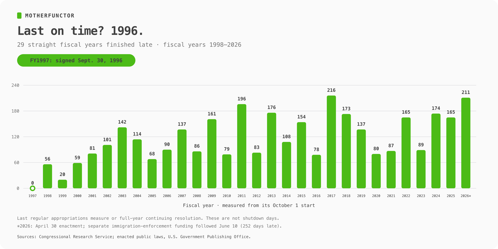

# Appropriations: how many days late?

**The last on-time finish was fiscal year 1997, completed September 30, 1996.** Every fiscal year since, through 2026, finished late.

A small, reusable dataset and a pair of MOTHERFUNCTOR LLC charts. Thirty rows. Source links included. No account, API key, or special software needed to use the data.



## Get the goods

- [Data: fiscal years 1997–2026 (CSV)](data/appropriations.csv)
- [Sources and verification notes](SOURCES.md)
- **1997–2026 chart:** [PNG](charts/motherfunctor-days-late-1997-2026.png) · [SVG](charts/motherfunctor-days-late-1997-2026.svg)
- **2007–2026 chart:** [PNG](charts/motherfunctor-days-late-2007-2026.png) · [SVG](charts/motherfunctor-days-late-2007-2026.svg)
- [Chart-generation script](scripts/build_charts.py)

GitHub displays the CSV as a table. Open it and choose **Raw** to access the plain file.

## What does “late” mean?

For each fiscal year, this records the enactment date of the **last regular annual appropriations measure or full-year continuing resolution**. A fiscal year starts October 1 of the preceding calendar year: fiscal year 2026 began October 1, 2025.

```text
elapsed days = enactment date − October 1 of the preceding calendar year
days late = max(0, elapsed days)
```

Nothing fancier than ordinary date subtraction here: enactment on October 1 would produce zero; October 2 would produce one. The operational goal is to have funding in place when the fiscal year begins. The one on-time observation here was enacted September 30, so its elapsed-day count is −1 and its days-late count is zero. This calculation may differ by one day from sources using inclusive counting.

**These are not (necessarily) shutdown days.** Continuing Resolutions often (but not always) kept agencies operating. A late final measure means that at least one agency was funded after 10/1; some received full-year funding earlier. (Later supplemental appropriations are excluded.)

### The 2026 footnote matters

The last regular appropriations measure became law April 30, 2026 (211 days after October 1). Specified immigration-enforcement funding was handled separately through reconciliation on June 10 (252 days). The main series uses April 30 to track the regular appropriations route. It does **not** claim all funding disputes ended then. Both dates and laws are documented in [SOURCES.md](SOURCES.md).

### What the data say

- Fiscal years **1998–2026:** 29 consecutive late finishes.
- Fiscal years **2007–2026:** average elapsed delay **137.75 days**, rounded to **138** on the chart; using June 10 for 2026 yields **139.8 days**.
- Historical context and identification of the last on-time year: [Congressional Research Service, R47235](https://www.congress.gov/crs-product/R47235). (XOXO CRS!)

Snapshot prepared **November 22, 2026**. Corrections are welcome; include a source and explain any change in the definition of completion.

## Columns

| Column | Meaning |
|---|---|
| `fiscal_year` | Fiscal year being funded, not necessarily the enactment year |
| `fiscal_year_start` | October 1 of the preceding calendar year, ISO date |
| `enactment_date` | Date the final measure became law, ISO date |
| `days_after_october_1` | Signed elapsed days; −1 for fiscal year 1997 |
| `days_late` | Elapsed days floored at zero; the plotted value |
| `public_law` | Public law number for the final measure |
| `full_year_CR` | Whether completion used a full-year continuing resolution for some or all regular appropriations |
| `source_url` | Enacted law or official metadata establishing the enactment date |
| `note` | Exceptions and verification details |

## Make or modify the charts yourself

The canonical source is `data/appropriations.csv`. Both charts are generated from that file.

1. Install Python 3 if needed. No Python packages are required.
2. From this repository’s folder, run:

   ```sh
   python3 scripts/build_charts.py
   ```

   This checks the dates and day counts, then regenerates both SVGs in `charts/`. Existing PNGs are included, so you can use them immediately.

3. To regenerate the PNGs too, install Node.js, then run:

   ```sh
   npm install
   npm run png
   ```

   The optional PNG exporter uses Sharp. Font rendering can vary by system; charts request Menlo, then DejaVu Sans Mono, then the system monospace font. No fonts are bundled.

Change colors and layout in `scripts/build_charts.py`. MotherFunctor’s palette here is green `#4cbb17`, charcoal `#404040`, and off-white `#fafafa`.

The current script builds the two published ranges ending in 2026. To extend the dataset to a new year, update the year-range validation, chart filenames, labels, and caveats in the script as well as the CSV. Rerun the scripts and check the resulting images before publishing.

## Reuse it. Seriously.

To the extent MotherFunctor holds copyright or related rights in this compilation, documentation, chart artwork, and code, they are dedicated to the public domain under **CC0 1.0 Universal**. Copy, modify, redistribute, and use commercially. Attribution is appreciated, **not required**. See [LICENSE](LICENSE) and the [CC0 explanation](https://creativecommons.org/publicdomain/zero/1.0/).

Linked third-party source materials retain their own legal status. CC0 does not grant trademark rights or imply MotherFunctor’s endorsement of a reuse. No government source documents or third-party fonts are bundled.

Optional credit: "Data compilation and charts: MOTHERFUNCTOR LLC; underlying sources: Congressional Research Service and enacted U.S. public laws."
